# Dial Down – Breathe and Relax

A calm iPhone app for breathing, stretching and body awareness. Tap a sore spot on a 3D body, pick the muscle you meant, and get the stretches that work it — then follow a guided session that pairs movement with breath.

*(Formerly "Breath: Relax & Stretch" — the repository and Xcode project still use that name.)*

<p align="center">
  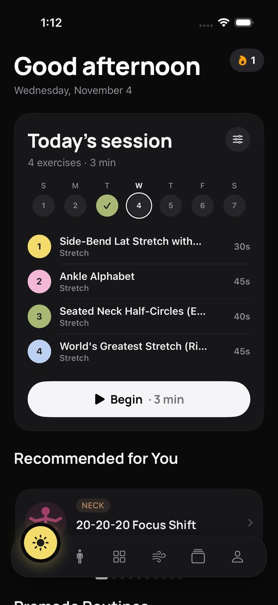
  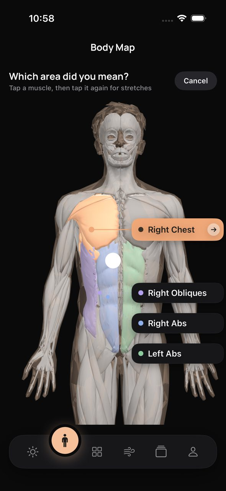
  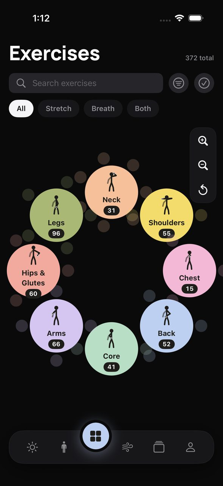
  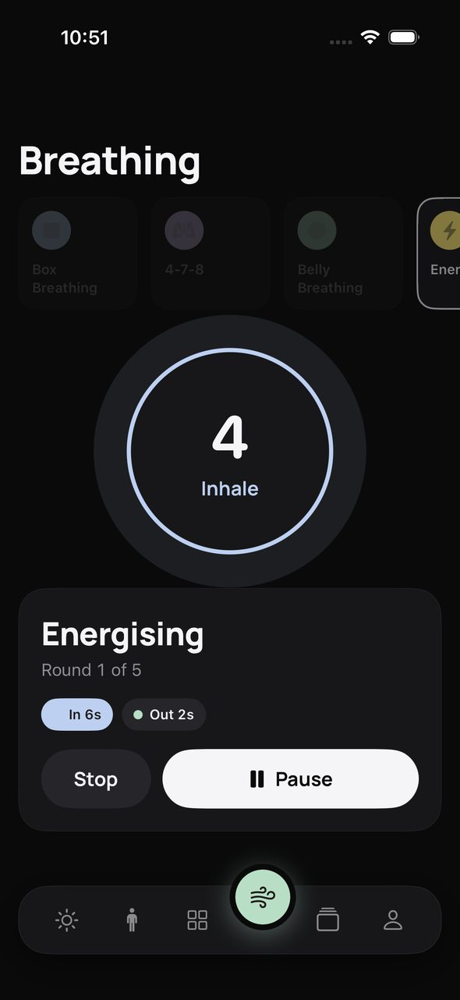
</p>

<p align="center">
  <b>iPhone · iOS 26+</b> · SwiftUI + SwiftData · SceneKit · Supabase · no third-party dependencies
</p>

---

## Contents

- [Feature tour](#feature-tour)
  - [Today](#today) · [Body Map](#body-map) · [Exercises](#exercises) · [Breathing](#breathing) · [Sessions](#sessions) · [Routines](#routines) · [Progress & Profile](#progress--profile) · [Sign-in & onboarding](#sign-in--onboarding)
- [How it works](#how-it-works)
  - [Architecture](#architecture) · [Launch & routing](#launch--routing) · [Tap-to-stretch](#tap-to-stretch-pipeline) · [Picking exercises across tabs](#picking-exercises-across-tabs) · [Session recording](#session-recording) · [Breathing engine](#breathing-engine) · [Offline-first sync](#offline-first-sync) · [Animation pipeline](#exercise-animation-pipeline)
- [Design system](#design-system)
- [Privacy](#privacy)
- [Building & running](#building--running)
- [Testing](#testing)
- [Project layout](#project-layout)
- [Project status](#project-status) · [License](#license)

---

## Feature tour

### Today

The home tab is one card that answers "what should I do right now?" — a time-of-day session (*Wake Up* in the morning, *Unwind* at night, *Today's session* in between), this week's activity at a glance, and the exercises numbered in order, with one white **Begin** button. Below it: rotating recommendations from your focus areas, premade routines, and a *For You* row.

<table>
  <tr>
    <td align="center"><br/><sub>Session card + week strip</sub></td>
    <td align="center">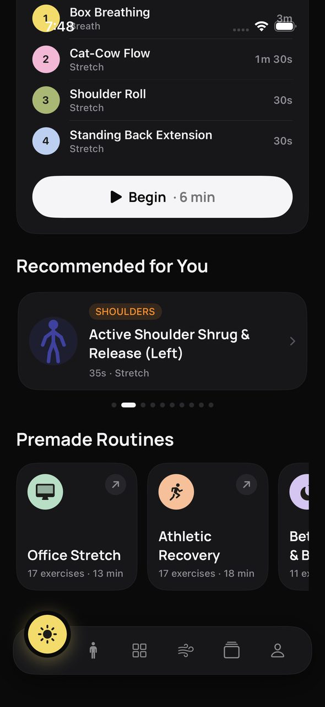<br/><sub>Recommendations & premade tiles</sub></td>
    <td align="center">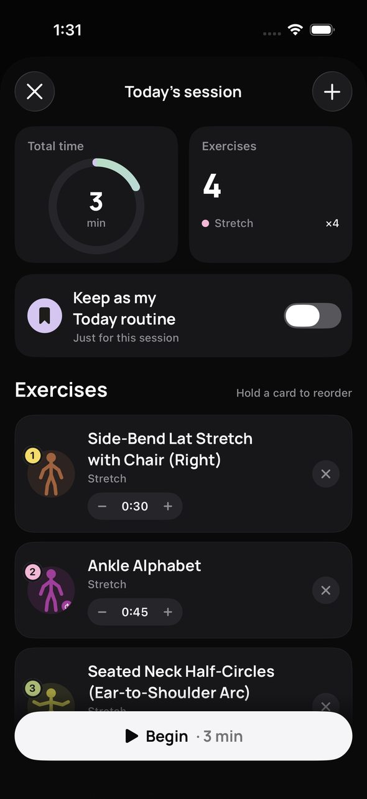<br/><sub>Customize: time ring, reorder, per-exercise time</sub></td>
  </tr>
</table>

- **Customize** opens the shared review screen: a total-time ring, a type breakdown, drag-to-reorder cards with a − / + time stepper, and an option to *keep it as my Today routine*.
- **Streaks** — the flame in the corner tracks consecutive days; streak savers protect a missed day.

### Body Map

A freely rotatable 3D anatomy figure. Tap where it hurts: the body turns to face the point, the skin fades to reveal the muscles underneath, and up to four candidate muscles light up in pastel with labels on the emptier side. Tap one to highlight it, tap again to see its stretches.

<table>
  <tr>
    <td align="center">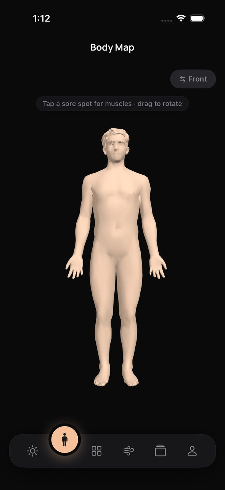<br/><sub>Rotate, pinch, tap a sore spot</sub></td>
    <td align="center"><br/><sub>"Which area did you mean?"</sub></td>
    <td align="center">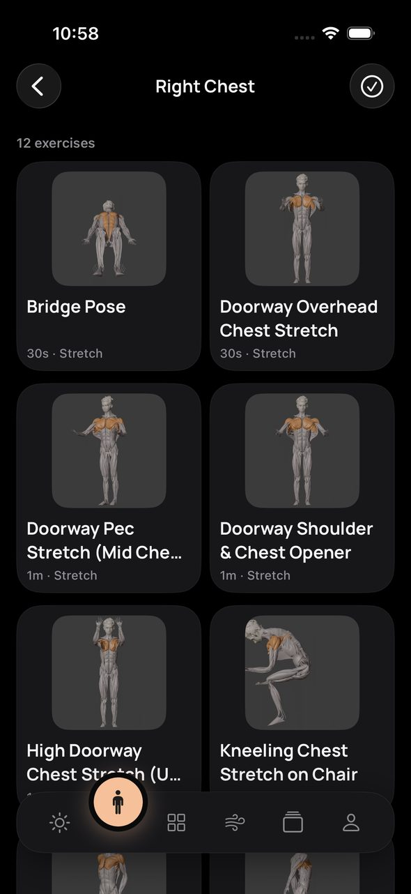<br/><sub>Stretches for that muscle</sub></td>
  </tr>
</table>

- The face fans out into evidence-based head zones (forehead, eyes, temples, jaw — left or right from where you tapped) instead of geometric hit boxes.
- Coarse regions are translated to the fine muscle names exercises use, with a same-area fallback so a muscle with few dedicated stretches still gets useful ones.

### Exercises

**372 exercises** across Neck, Shoulders, Chest, Back, Core, Arms, Hips & Glutes and Legs — most with a looping demo rendered from the same anatomy model, working muscles highlighted.

<table>
  <tr>
    <td align="center"><br/><sub>Zoomable bubble map by body area</sub></td>
    <td align="center">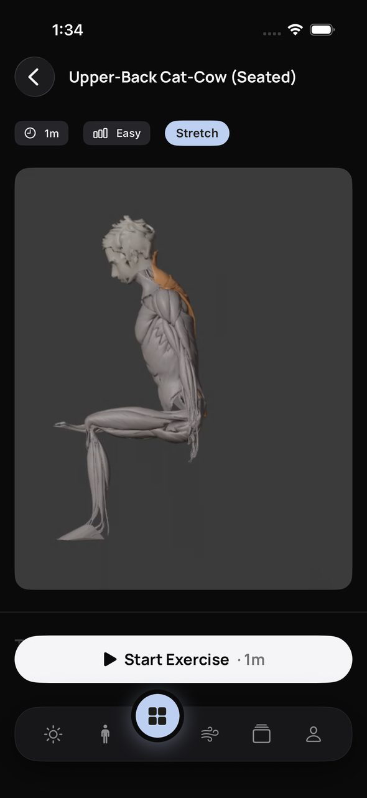<br/><sub>Demo loop, targets, steps</sub></td>
    <td align="center">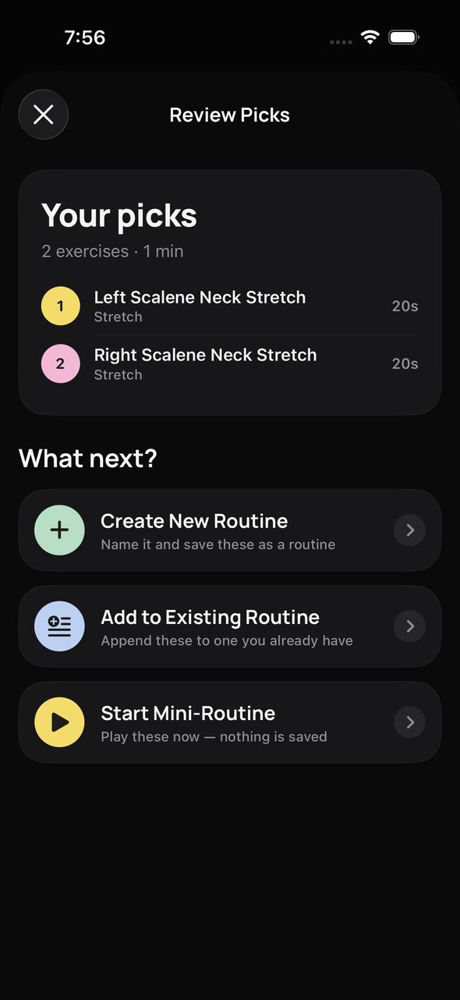<br/><sub>Select several → Review Picks</sub></td>
  </tr>
</table>

- **Bubble map** — each body area is a pastel node with its exercises orbiting it; zoom in to focus a group. Search and Stretch / Breath / Both chips sit on top.
- **Detail** — duration, difficulty, type, target muscles, numbered instructions, a safety caution where relevant, and a medical disclaimer.
- **Select mode** — pick exercises anywhere in the app, then create a routine, add them to an existing one, or play them once as a mini-routine.

### Breathing

Box, 4-7-8, Belly, Energising, and a custom pattern you set yourself. A graphite disc ringed in pastel grows on the in-breath and settles on the out-breath — blue in, lavender hold, mint out — while the current phase chip lights up in the card below.

<table>
  <tr>
    <td align="center">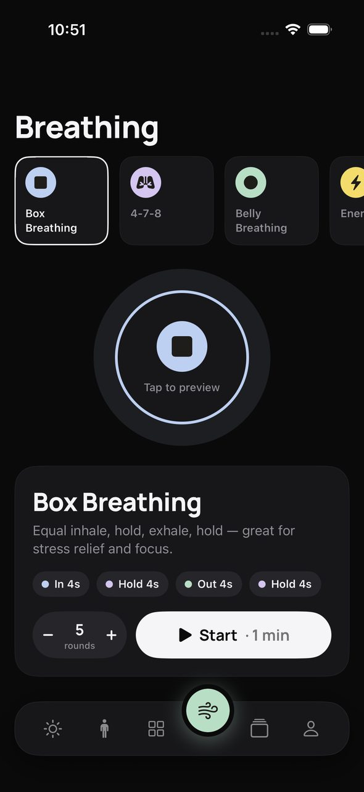<br/><sub>Pick a pattern and rounds</sub></td>
    <td align="center"><br/><sub>Mid-session: countdown + phase chips</sub></td>
  </tr>
</table>

- Tap the circle to preview one round without it counting as a session.
- Optional voice cues and light haptics on every phase change; the screen stays awake only while a session runs.

### Sessions

<table>
  <tr>
    <td align="center">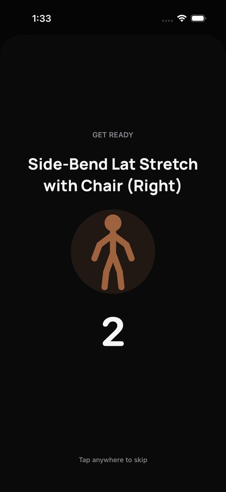<br/><sub>Get Ready 3-2-1 (with caution, if any)</sub></td>
    <td align="center">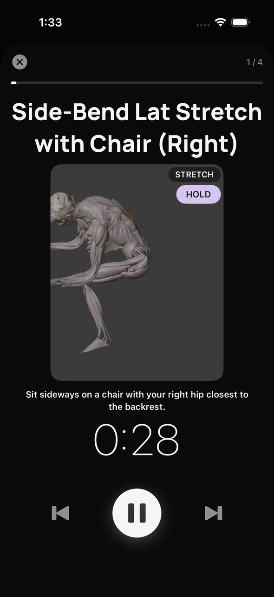<br/><sub>Player: demo, cue, countdown</sub></td>
  </tr>
</table>

- A get-ready countdown before each exercise (auto-skip in Settings), the demo loop, a *Hold* / *Keep Going* cue, previous / pause / next, an *Up Next* card near the end, and side-switch cues for one-sided stretches.
- Finishing records the session once — streak, points, badges, Apple Health and Calendar all update together (see [Session recording](#session-recording)).

### Routines

<table>
  <tr>
    <td align="center">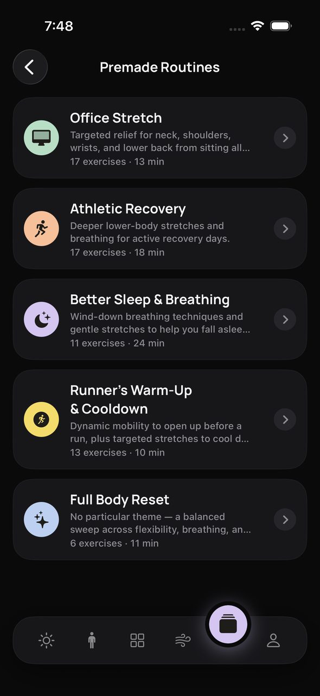<br/><sub>Premade routines</sub></td>
    <td align="center">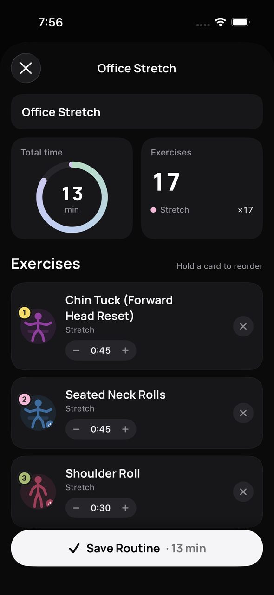<br/><sub>Opened in Customize, ready to save</sub></td>
  </tr>
</table>

- Five curated routines (Office Stretch, Athletic Recovery, Better Sleep & Breathing, Runner's Warm-Up & Cooldown, Full Body Reset) open in the same Customize screen as Today — rename, trim, retime, save.
- Build your own, pin one as your Today routine, share a routine by link, import a friend's, or send a streak challenge.

### Progress & Profile

<table>
  <tr>
    <td align="center">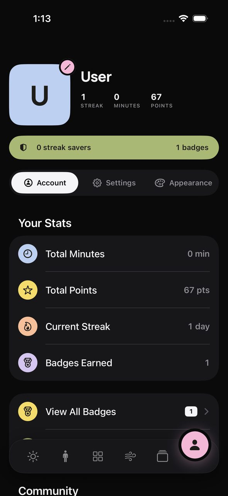<br/><sub>Profile: streak, minutes, points</sub></td>
    <td align="center">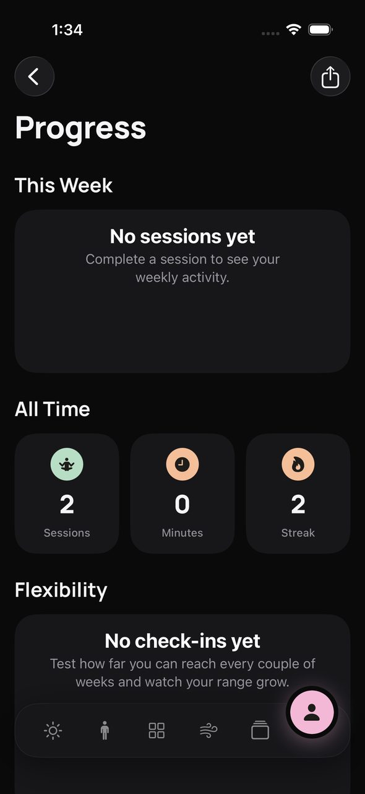<br/><sub>Progress & Charts</sub></td>
  </tr>
</table>

- Weekly activity, all-time stats, a flexibility check-in (toe touch, shoulder reach, neck rotation, butterfly), a streak calendar, a year-in-review heatmap and a points chart.
- Badges, streak savers you can buy with points, a shareable streak card, and an opt-in leaderboard that only ever shows a generated nickname.
- Settings: goals, language (English, Español, Français, 简体中文), voice cues, reminders, Apple Health, Calendar, app lock, data export and in-app account deletion.

### Sign-in & onboarding

<table>
  <tr>
    <td align="center">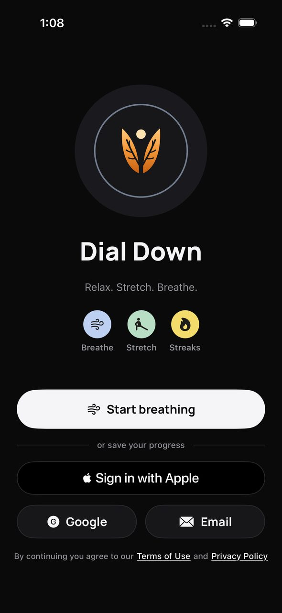<br/><sub>Guest-first sign-in</sub></td>
    <td align="center">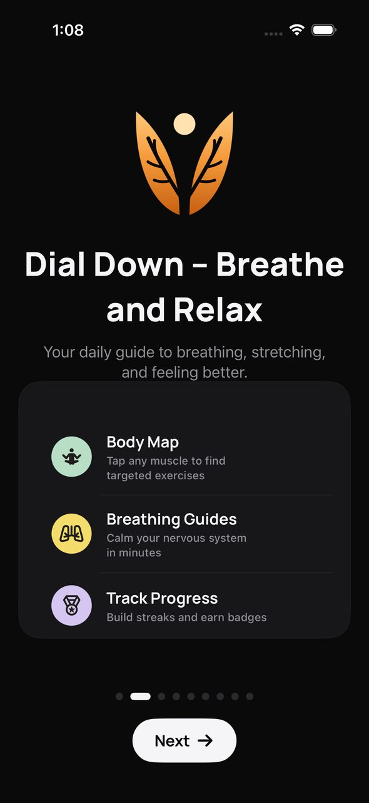<br/><sub>Welcome</sub></td>
    <td align="center">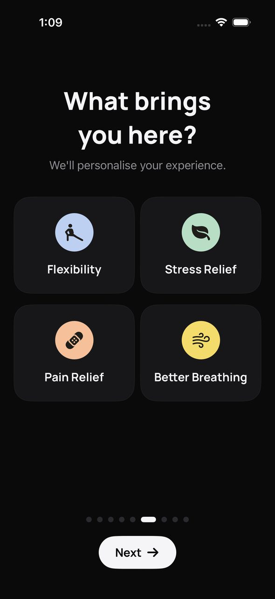<br/><sub>Goals</sub></td>
    <td align="center">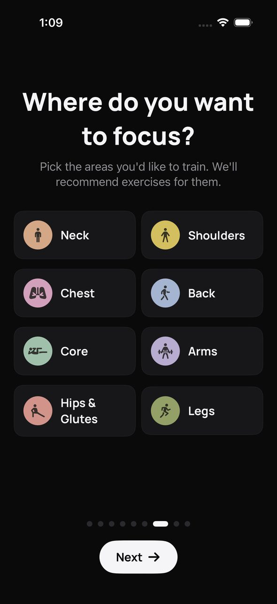<br/><sub>Focus areas</sub></td>
  </tr>
</table>

- **Start breathing** uses the app straight away with no account. Apple, Google or email are there for people who want backup and sync.
- Onboarding: language → welcome → three feature showcases → goals → focus areas → body map intro → notifications, then a coach-mark tour of the real UI.

---

## How it works

### Architecture

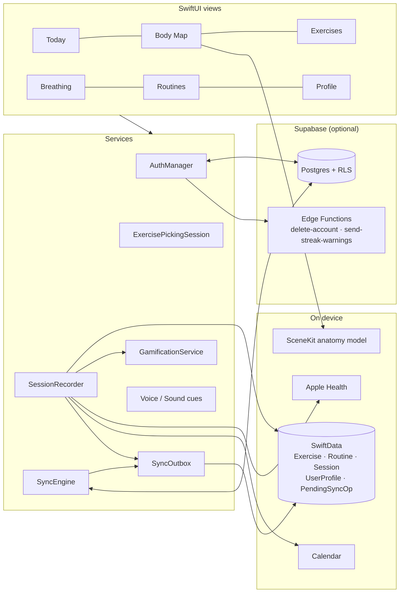

Everything a screen needs lives on the device first. The backend is only reached through `AuthManager` (sign-in, profile) and `SyncEngine` (routines and sessions), over plain `URLSession`.

### Launch & routing

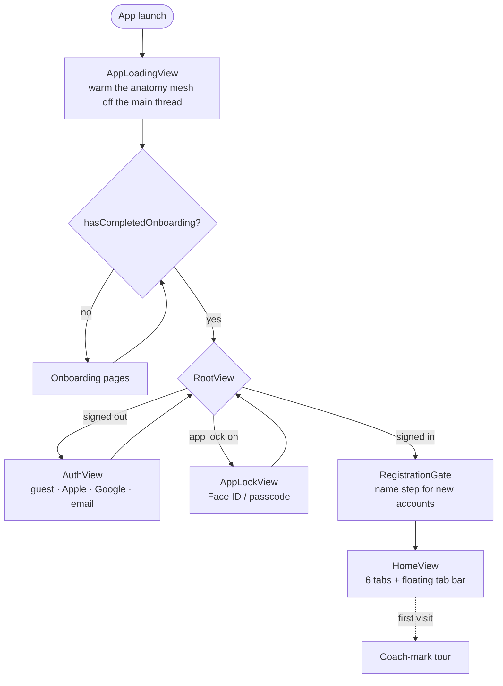

On first launch the app seeds the exercise library from bundled JSON; later launches run versioned `SeedMigrator` steps, so new or renamed exercises arrive without touching the user's routines.

### Tap-to-stretch pipeline

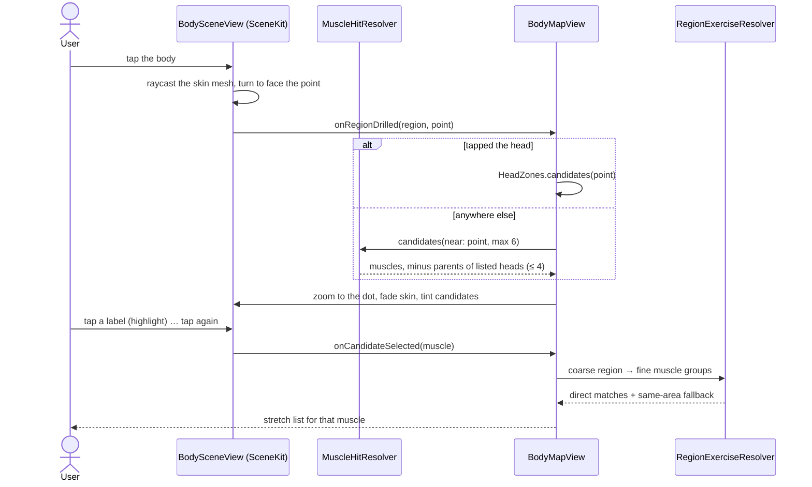

Hit-testing is pure Swift against proxy volumes (`BodyHitVolumes`), so the figure stays freely rotatable at all times and the logic is unit-tested without SceneKit.

### Picking exercises across tabs

`ExercisePickingSession` is an app-wide object, so a pick can start in one tab, continue through any number of tab switches, and return where it began.

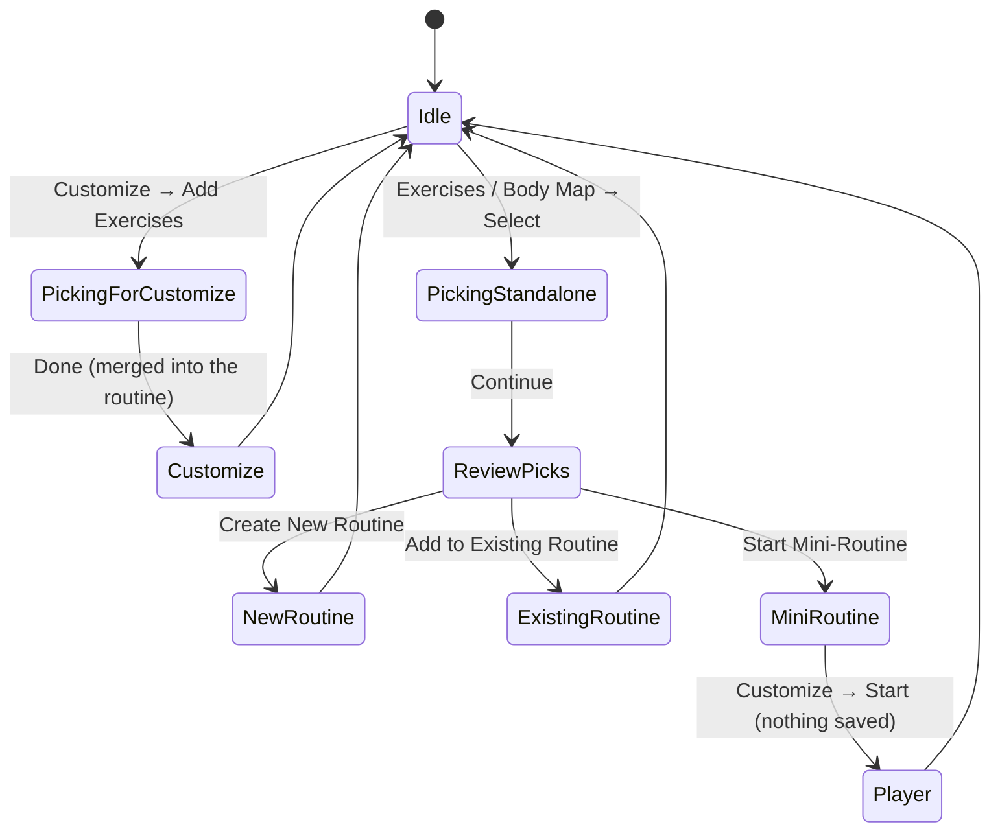

### Session recording

Stretch sessions and breathing sessions both finish through one function, `SessionRecorder.record`, so the two can't drift apart.

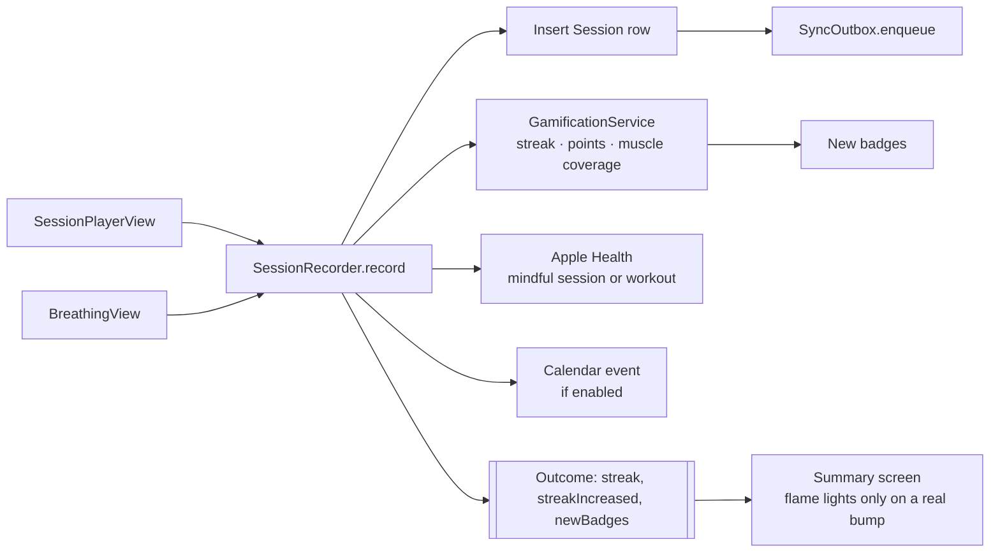

### Breathing engine

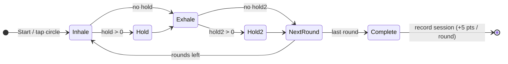

Each phase stores a wall-clock end time rather than counting ticks, so backgrounding the app doesn't stall the countdown — on return it walks forward through any phases that already elapsed. A circle-tap preview runs the same machine but never records a session.

### Offline-first sync

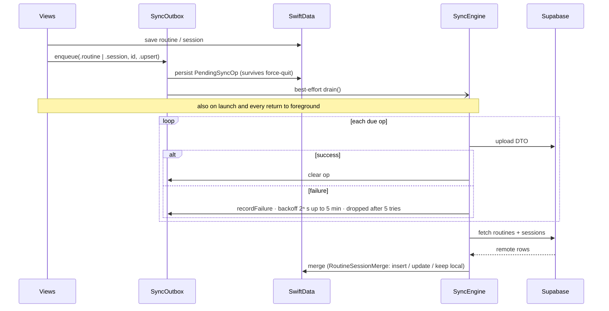

Push always runs before pull, so a local edit still waiting in the outbox can't be overwritten by an older server copy. Merge decisions live in `RoutineSessionMerge`, a pure, unit-tested type.

### Exercise animation pipeline

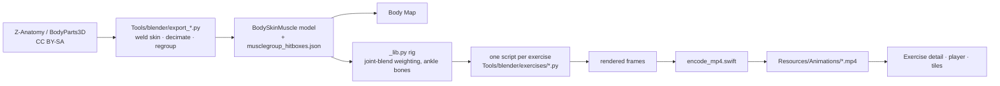

Every demo loop can be regenerated from source. Exercises whose motion is still an approximation carry an `animationIsApproximate` flag and show a note in the app. Hand-off notes: [`Tools/blender/exercises/ANIMATION_HANDOFF.md`](Tools/blender/exercises/ANIMATION_HANDOFF.md).

---

## Design system

The look is **modern black with pastel accents**: a near-black page, graphite cards with hairline edges instead of shadows, white primary buttons, and pastels used sparingly — icon circles, number badges, the active tab and selected states.

| Token | Dark (the design) | Used for |
|---|---|---|
| `luminaSurface` | `#0A0A0B` | page background |
| `luminaCardFill` | `#17171A` | cards, tiles |
| `luminaContainer` | `#26262A` | chips, steppers, secondary buttons |
| `luminaPrimary` | `#F5F5F7` | primary buttons, headings |
| `luminaOnSurfaceVariant` | `#8E8E93` | secondary text |
| pastels | <code>#BED0F1</code> blue · <code>#B9DEC6</code> mint · <code>#D4C6F0</code> lavender · <code>#F4DC6C</code> yellow · <code>#F5C09A</code> peach · <code>#F4B8D7</code> pink · <code>#A9B874</code> olive · <code>#F2A99E</code> coral | icon circles, tags, phase colors — always with ink (`#1E1D1A`) text |

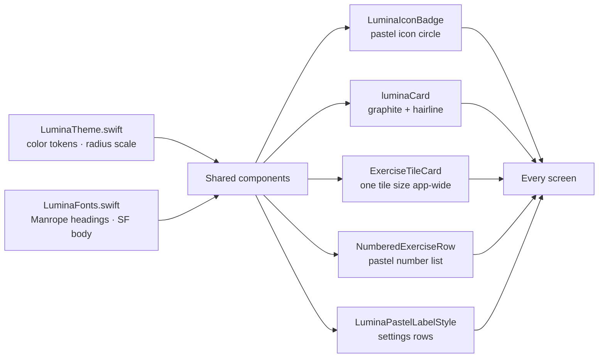

- Each body area has a fixed pastel (`ExerciseCategory.pastel`); anything else gets a stable one from `Color.pastel(for:)`, so a given icon always gets the same color.
- Headings use Manrope ExtraBold / Bold; body text stays on the system font for Dynamic Type.
- The custom tab bar pops the active tab out as a pastel circle with a spring, and honours Reduce Motion.

---

## Privacy

Local-first by design. Without an account, nothing leaves the device: sessions, routines, streaks and body-map marks live in SwiftData. Signing in is optional. If you do, your name, progress stats, session history and routines are synced to the backend under your account ID (your email is held by the auth provider), and the opt-in leaderboard shows only a generated nickname. Apple Health data, calendar data, the profile photo and body-map marks never leave the device. No tracking, no ads, no purchases.

- **Yours to keep** — use it without an account, export all your data, or delete your account in-app (Profile → Account), which erases the server copy and revokes Sign in with Apple.
- Privacy Policy: [hosted](https://jasqnlu.github.io/Dial-Down---Breathe-and-Relax/privacy.html) · [source](Breath%20-%20Relax%20%26%20Stretch/Legal/PrivacyPolicy.html)
- Terms of Use: [hosted](https://jasqnlu.github.io/Dial-Down---Breathe-and-Relax/terms.html) · [source](Breath%20-%20Relax%20%26%20Stretch/Legal/TermsOfUse.html)
- Support: [jasqnlu.github.io/Dial-Down---Breathe-and-Relax/support.html](https://jasqnlu.github.io/Dial-Down---Breathe-and-Relax/support.html)

---

## Building & running

Requirements: a recent Xcode with the iOS 26 SDK. The app targets **iPhone, iOS 26.0 and later** (on iPad it runs the iPhone layout).

1. Clone the repo and open `Breath - Relax & Stretch.xcodeproj`.
2. Choose the `BreathRelaxStretch` scheme and an iPhone simulator, and run. The app works offline with no extra setup.
3. To run on a device, or to use Sign in with Apple, set your own Team and bundle identifier under *Signing & Capabilities*.

### Running without the Simulator window

Some Xcode installs ship without the Simulator app. `Tools/run-simulator.sh` builds, installs and launches the app on a headless simulator and saves a screenshot:

```sh
Tools/run-simulator.sh            # open on Today, skipping onboarding and sign-in
Tools/run-simulator.sh 2          # 0 Today · 1 Body · 2 Exercises · 3 Breathe · 4 Routines · 5 Profile
FRESH=1 Tools/run-simulator.sh    # wipe the app first to see real onboarding
```

Any `@AppStorage` key can be overridden for one launch the same way, e.g. `-hasCompletedOnboarding YES -auth.isSignedIn YES -auth.provider guest`.

### Using your own backend

The Supabase URL and publishable key in `SupabaseService.swift` point at the author's project; row-level security is what protects the data. To use your own:

1. Create a Supabase project and run `supabase_schema.sql` in the SQL Editor. The file is applied by hand, so keep the live database in step with it; a missing column once broke routine sync.
2. Enable the Apple auth provider, and swap your URL and key into `SupabaseService.swift`.
3. Deploy the functions with `supabase functions deploy <name>`, and set their secrets with `supabase secrets set`:
   - `delete-account` needs `APPLE_TEAM_ID`, `APPLE_CLIENT_ID` (the bundle ID), `APPLE_SIWA_KEY_ID` and `APPLE_SIWA_KEY_P8` (a Sign in with Apple key). It revokes Sign in with Apple first, then deletes the user's rows and auth record, failing closed so nothing is half-deleted.
   - `send-streak-warnings` needs `APNS_AUTH_KEY_P8` and `CRON_SHARED_SECRET`.

### Updating the legal pages

The in-app `Legal/*.html` files are the source of truth for the hosted Privacy Policy and Terms (the URLs App Store Connect uses). After changing one, merge it, then run `Tools/publish_legal_pages.sh` (add `--dry-run` to preview) to update the website on the `gh-pages` branch.

---

## Testing

| Suite | What it covers | Run |
|---|---|---|
| Unit tests (Swift Testing, ~660 tests) | hit resolution, graph layout, sync merge, seed migrations, gamification, breathing cycles, theme tokens | ⌘U, or `xcodebuild test … -only-testing:"Breath - Relax & StretchTests"` |
| UI tests (XCUITest) | onboarding, registration, picking & mini-routine flows, session player layout, body map | `-only-testing:"Breath - Relax & StretchUITests/<Class>"` |
| Screenshot sweeps | `ModernRestyleScreenshotTests` opens every tab and the main inner screens and attaches screenshots — the images in this README come from it | export with `xcrun xcresulttool export attachments` |
| Edge Functions | `delete-account` | `cd supabase/functions/delete-account && deno test` (Deno 2) |

```sh
xcodebuild test -project "Breath - Relax & Stretch.xcodeproj" -scheme BreathRelaxStretch \
  -destination 'platform=iOS Simulator,name=iPhone 17' \
  -only-testing:"Breath - Relax & StretchTests"
```

---

## Project layout

```
Breath - Relax & Stretch/        App target
  Models/                        SwiftData models and domain types (Exercise, Routine, Session, hit volumes…)
  Services/                      Auth, Supabase, sync, session recording, gamification, HealthKit, cues
  Views/                         Home, BodyMap, Exercises, Breathing, Routines, Session, Profile, Onboarding, Auth
    Theme/                       LuminaTheme, LuminaFonts, DialDownMark and shared components
  Resources/                     Seed data, 3D models, demo videos, string catalog
  Legal/                         Privacy Policy, Terms, Credits (bundled HTML; also published to the website)
Breath - Relax & StretchTests/   Unit tests
Breath - Relax & StretchUITests/ UI tests and screenshot sweeps
supabase/                        Edge Functions (Deno) and config
Tools/blender/                   Anatomy export and exercise animation scripts
Tools/run-simulator.sh           Headless build-install-launch-screenshot helper
Tools/publish_legal_pages.sh     Publishes Legal/ and the support page to GitHub Pages
docs/                            Design notes, plans, readiness checklists, README images
```

---

## Project status

Version 1.0 for iPhone was submitted to the App Store in October 2026. The modern black + pastel redesign shown here lives on the `seperate-main` branch. A proper iPad layout is planned for a later update. See [`TODO.md`](TODO.md) for other work in progress.

## License

- **Source code** — [Mozilla Public License 2.0](LICENSE). Modified versions of MPL-licensed files must stay under MPL-2.0 when distributed; you can combine them with code under other licenses.
- **Body-map anatomy and exercise animations** — the 3D body map is built from [Z-Anatomy](https://www.z-anatomy.com), which is itself built on [BodyParts3D](https://dbarchive.biosciencedbc.jp/en/bodyparts3d/download.html) (© Kousaku Okubo / DBCLS). Both are licensed **CC BY-SA**, so the meshes, the metadata derived from them, and every exercise video rendered from them are distributed under [CC BY-SA 4.0](https://creativecommons.org/licenses/by-sa/4.0/) rather than MPL-2.0. This covers `Resources/Models3D/`, `Resources/Animations/`, `skinmuscle_node_names.json`, `musclegroup_hitboxes.json` and `Tools/blender/generated/`. The source was modified: skin patches welded into one shell, muscles decimated for mobile, objects regrouped into the app's muscle categories, and the result posed and rendered into the demo loops. Full credits and the list of changes are in [`ASSET_CREDITS.md`](ASSET_CREDITS.md).
- **Typeface** — [Manrope](https://github.com/sharanda/manrope), SIL Open Font License 1.1.

If you fork or redistribute anything derived from the anatomy assets, you must credit Z-Anatomy and BodyParts3D, link the CC BY-SA 4.0 license, say what you changed, and license your derivative under CC BY-SA 4.0 too.
